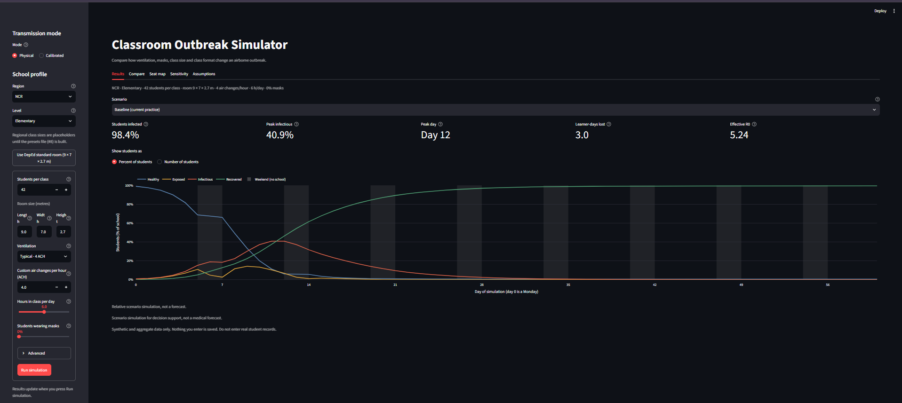

# ClassPass: Classroom Outbreak Simulator

**Compare how ventilation, masks, class size, and class format change an airborne outbreak.**

[](https://github.com/labillescharlene21-lab/classPass/actions/workflows/ci.yml)

* **Live Demo:** Currently runs locally. See the Quickstart below.
*   **Demo Video:** [Link to be added Oct 24]

## Problem
School administrators currently have to choose between in-person, hybrid, or online classes without clear, data-driven tools to evaluate the risk of airborne disease transmission. Decisions are often made based on intuition rather than modeling. ClassPass solves this by providing a simulation tool that couples an environmental Wells-Riley model with an epidemiological SEIR model. This allows decision-makers to compare the relative impacts of interventions like improved ventilation, mask mandates, and smaller class sizes.

## Screenshot


## How It Works
The simulation follows a two-step pipeline: 

```mermaid
graph TD
    A[Input: params.yaml & Sidebar] --> B(Wells-Riley Model)
    B --> C{Calculate Transmission Rate β}
    C --> D(SEIR Model)
    D --> E[RK4 ODE Solver]
    E --> F[Results & Sensitivity Dashboard]