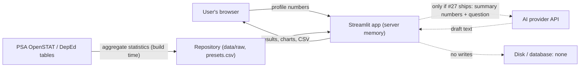

# Privacy and responsible use

**Status:** DRAFT for sign-off (ticket #29). Written 2026-10-21. This is a design document, not legal advice.
**Sign-off needed:** PM (completeness), one developer (accuracy of the data-flow claims in sections 2 and 3), C2 (verify the items in section 9).

Statements about the law carry a source tag like **[L1]**. Each tag is defined in the Sources table at the end, with what was checked and whether it is verified.

## 1. Summary

The Classroom Outbreak Simulator compares what different ventilation, mask, class-size and class-format choices would do to an airborne outbreak in one classroom. It is a demo built for a competition.

- It works on **synthetic and aggregate inputs only**: class size, room size, ventilation and session length. None of these identifies a student.
- It **does not save** anything you enter: no file, no database, nothing in the page address.
- It **never asks for real student records**, and the in-app notice tells users not to enter any.
- Results are **scenario comparisons, not forecasts or medical advice**.

The reason for this design is that health and education information about an individual is "sensitive personal information" under Philippine law, and processing it is prohibited except in specific cases [L1]. The safest way for a demo to comply is to never handle it.

## 2. What each feature handles

| Feature | What the user enters | Where it lives | Saved to disk or database? | Sent to a third party? | Retention |
|---|---|---|---|---|---|
| School profile (sidebar) | Region, level, class size, room size, ventilation, hours, mask use | Browser session (server memory while the session is open) | No | No | None |
| Results, Compare, Seat map | Nothing extra; seat labels such as `B3` for where an infected student sits | Browser session | No | No | None |
| Simulation cache | Nothing; numbers computed from the inputs above | Server memory, keyed by the input numbers, until the app restarts | No | No | Until restart; holds no personal information |
| CSV download (Compare tab) | Nothing | Built in memory and sent to the user's browser | No | No | None |
| Teacher log (#28, planned) | Synthetic student IDs and status | Browser session only | No | No | None |
| AI assistant (#27, planned) | Free-text questions | Sent to the AI provider with summary numbers | No | **Yes**: AI provider (section 5) | Set by the provider (section 5) |
| Hosting (Streamlit Community Cloud) | n/a | Platform logs | Not controlled by us | Platform | **Not verified**: see section 9 |
| Source code (GitHub) | n/a | Repository | Yes, but it holds no personal data | GitHub | n/a |

Rules the code follows. Rules 1 and 2 are checked automatically in `tests/test_privacy.py`; rule 3 is checked by review:

1. No code writes user input to a file, database or pickle.
2. No code puts user input in the page address (query parameters).
3. The seat map and teacher log use labels and synthetic IDs, never names.

## 3. Data flow

Solid lines are in the current app. Dotted lines are planned or absent by design. The regional presets come from published aggregate statistics, not from student records.

## 4. Why this design (Data Privacy Act of 2012, RA 10173)

- **What counts as personal information.** Information from which a person's identity is apparent or can be reasonably and directly ascertained, or which together with other information would directly and certainly identify them [L1 §3(g)]. A class size, a room size or an air-change setting does not do that. This is our assessment, not a legal opinion.
- **What counts as sensitive.** Information about an individual's health or education is sensitive personal information [L1 §3(l)(2)]. A student's illness status and school record are both.
- **Why we avoid it.** Processing sensitive personal information is prohibited unless a listed case applies; the main one for a school tool is consent specific to the purpose and given before processing [L1 §13]. A competition demo cannot collect that consent for real students, so the demo never receives real records.
- **Principles we follow anyway.** Personal information must be collected for a declared, legitimate purpose, be adequate and not excessive, and be kept only as long as needed [L1 §11]. Collecting nothing and keeping nothing satisfies this by design.
- **If a school used this with real records.** The school would be the personal information controller. A controller that subcontracts processing stays responsible for safeguards [L1 §14], remains accountable for data sent to a third party at home or abroad [L1 §21], and must apply reasonable security measures and notify the National Privacy Commission and affected people of a qualifying breach [L1 §20]. That use is out of scope for this demo and would need a privacy impact assessment, a notice, consent from students or their guardians, and a data processing agreement with any provider.
- **Exemptions we do not rely on.** The Act does not apply to personal information processed for journalistic, artistic, literary or research purposes [L1 §4(d)]. We do not rely on this for the demo; we avoid personal information instead.
- **Schools and minors.** National Privacy Commission guidance for schools, as reported in the press, treats education information as sensitive and says consent comes from the student or, for minors, from a guardian [L2]. The original advisory opinion still needs to be located and cited (section 9).

## 5. AI assistant disclosure (ticket #27, if shipped)

**Sent to the AI provider:** the current scenario results, the school profile numbers, the parameter assumptions, and the user's typed question.
**Never sent:** student names, student IDs, roster rows, or anything from the teacher log other than aggregate counts.
**Human review:** every draft (parent advisory, memo, text message) is a suggestion. The in-app label says "AI-generated draft. Review before you send." Nothing is sent automatically.
**Not medical advice:** the assistant must refuse diagnosis requests and refer to the school nurse and Department of Health guidance.

**Provider terms.** Anthropic's API documentation states that retained data is never used for model training without express permission, and that conversation content is not retained by default, except for certain "Covered Models" that require 30-day retention [L3]. Third-party articles quote different retention windows (7 and 30 days), so we rely only on the official page. **Before launch, read that page for the exact model name used and record the retention it states here.**

## 6. Third-party processing

| Party | Role | Personal data? | Status |
|---|---|---|---|
| AI provider (Anthropic API) | Processes questions and summary numbers to write drafts | None by design | Terms read at [L3]; confirm the model's retention before launch |
| Streamlit Community Cloud | Hosts the app | None by design | Platform logging not verified |
| GitHub | Hosts the code | None | n/a |
| PSA OpenSTAT / DepEd | Sources of aggregate statistics | None | Terms in section 7 |

## 7. Data-source terms and attribution

**PSA OpenSTAT.** The tables are published under the Creative Commons Attribution license. Reuse is free, including remixing, if you give credit to the PSA or the source agency named in the dataset, link to the PSA terms page, say whether you changed the data, and do not suggest the PSA or source agency endorses you. The terms also ask that technical notes needed to understand the data be included [L4].

**DepEd.** The enrollment tables we use are published through PSA OpenSTAT with DepEd as the source agency, so the PSA terms above apply to them. We did not find a separate DepEd reuse license for DepEd's own pages and files. Until C2 confirms one (section 9), treat DepEd-hosted files as "cite and link, do not imply endorsement", and commit to the repository only the PSA exports and our own derived tables, not DepEd's original files.

**Attribution text for the README and the app's Assumptions tab (paste as is, fill in the access dates):**

> Regional enrollment and school figures: Philippine Statistics Authority, OpenSTAT (source agency: Department of Education), https://openstat.psa.gov.ph, licensed under CC BY 4.0 (terms: https://openstat.psa.gov.ph/Terms). Accessed [date]. We filtered, merged and divided the figures to compute learners per classroom by region and level. Changes were made by the project team. This project is not endorsed by the PSA or DepEd.

## 8. Checklist for the bug bash (ticket #20)

Run on the deployed app, not only locally.

- [ ] Footer shows the scenario-simulation line and the synthetic-data line on every tab.
- [ ] Assumptions tab shows the privacy notice.
- [ ] After using every control, the page address has no query parameters or fragments containing inputs.
- [ ] `python -m pytest tests/test_privacy.py` passes (no file, database or address writes).
- [ ] Browser developer tools, Network tab: with the AI assistant off, the page sends no requests to any host other than the app's own.
- [ ] With the AI assistant on: inspect one request payload. It contains summary numbers and the typed question only, with no names or IDs.
- [ ] Teacher log (if shipped): the roster uses synthetic IDs, "Clear data" empties it, and a reload shows it gone.
- [ ] App logs (local terminal and the hosting dashboard) contain no roster rows or seat assignments.
- [ ] The README links to this document.

## 9. Open items before sign-off

1. **[L2]** Find the National Privacy Commission advisory opinion on schools and cite it directly, with its number and date, instead of the press report.
2. **Streamlit Community Cloud** logging and data handling: read the platform's terms and record what they say in section 2.
3. **DepEd reuse terms**: confirm whether DepEd publishes a license for its own data pages; update section 7.
4. **Anthropic model retention**: record the retention shown on the official page for the exact model used (section 5).
5. **Developer review** of sections 2 and 3 against the code.
6. Read the Implementing Rules and Regulations of the Act if the team wants to cite them; this draft cites the Act only.

## Sources

| Tag | Source | What was checked | Status |
|---|---|---|---|
| L1 | Republic Act No. 10173, Data Privacy Act of 2012, full text on the National Privacy Commission site: https://privacy.gov.ph/wp-content/uploads/2017/03/DPA-of-2012.pdf | Read in full on 2026-10-21: sections 3(g), 3(l), 4(d), 11, 12, 13, 14, 20, 21 | Verified |
| L2 | Press report quoting an NPC advisory opinion on schools: https://www.sunstar.com.ph/baguio/opinion/does-your-school-have-a-data-privacy-policy | Statement that education information is sensitive and that minors' consent comes from guardians | Partial: secondary source; cite the NPC original |
| L3 | Anthropic, "API and data retention": https://platform.claude.com/docs/build-with-claude/api-and-data-retention | Read 2026-10-21: no training on retained data without permission; conversation content not retained by default; Covered Models require 30-day retention | Verified for the page's content; exact model needs checking |
| L4 | PSA OpenSTAT Terms of Use: https://openstat.psa.gov.ph/Terms | Read 2026-10-21: CC BY, attribution conditions, no-endorsement and no-additional-restrictions terms | Verified |

